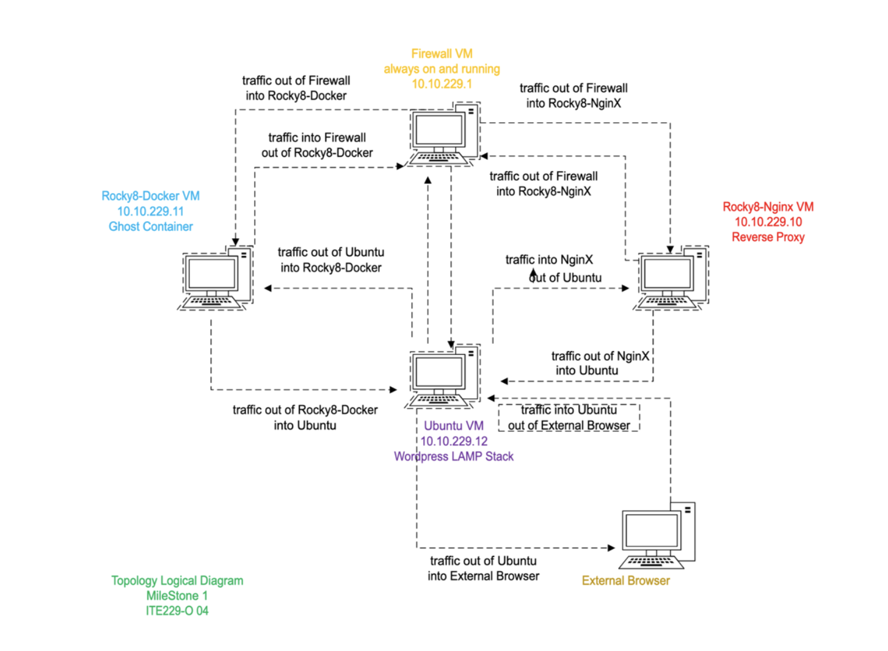
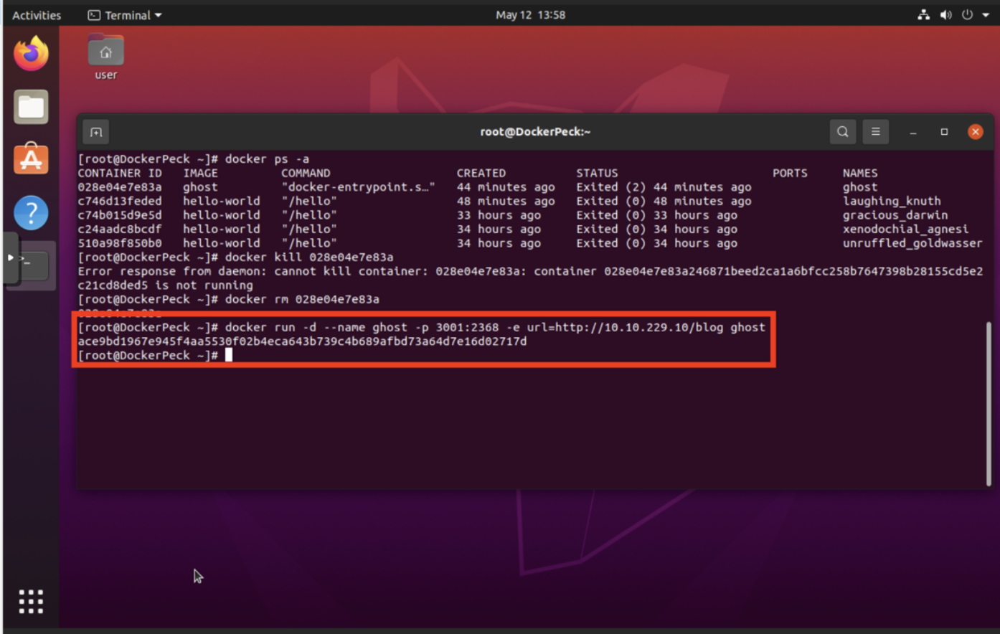
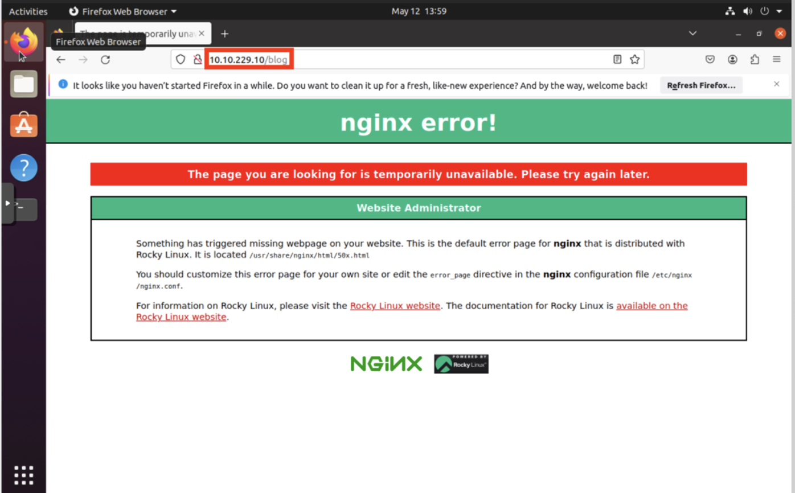
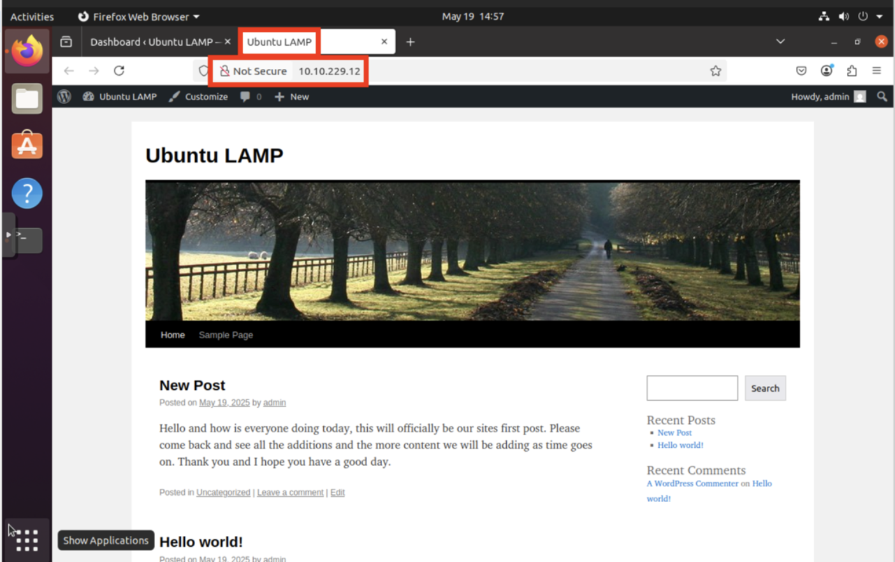
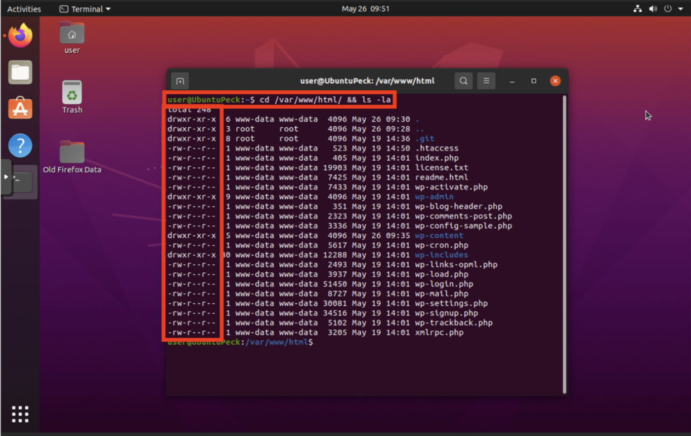

# Secure Linux Web Infrastructure

## Project Overview

This project focused on building and securing a multi-host Linux web environment using Docker, Ghost, Nginx, Ubuntu, Apache, MySQL, PHP, and WordPress.

The environment included a firewall, a Rocky Linux Docker host, a Rocky Linux Nginx reverse proxy, and an Ubuntu LAMP server. I deployed a Ghost container, configured Nginx to proxy traffic to the application, built a WordPress site on a LAMP stack, and reviewed WordPress file permissions as part of the security-hardening process.

The project demonstrates Linux administration, containerization, reverse proxy configuration, web server deployment, WordPress implementation, and basic web infrastructure hardening.

## Objectives

- Build a multi-host Linux web environment.
- Deploy a Ghost application using Docker.
- Configure Nginx as a reverse proxy.
- Build an Ubuntu LAMP stack.
- Configure Apache, MySQL, PHP, and WordPress.
- Validate web services through browser testing.
- Review WordPress file permissions.
- Apply basic security-hardening practices.
- Document troubleshooting and validation results.

## Architecture

The lab environment used multiple virtual machines with separate responsibilities:

- Firewall VM
- Rocky Linux Docker host
- Ghost container
- Rocky Linux Nginx reverse proxy
- Ubuntu LAMP/WordPress server
- External browser/client

*Network topology showing the firewall, Docker/Ghost host, Nginx reverse proxy, Ubuntu WordPress server, and client traffic flow.*

## Tools & Technologies

- Rocky Linux
- Ubuntu Linux
- Docker
- Ghost
- Nginx
- Apache2
- MySQL
- PHP
- WordPress
- SSH
- Linux file permissions
- Reverse proxy configuration
- Virtual machines

## Ghost Application Deployment

Docker was used to deploy a Ghost application container on the Rocky Linux Docker host.

The Ghost container was configured with a dedicated name, application port mapping, and a URL corresponding to the Nginx reverse-proxy path.

*Docker command used to deploy the Ghost container and map the application to the required port.*

## Nginx Reverse Proxy

Nginx was configured on a separate Rocky Linux system to act as a reverse proxy for the Ghost application.

A `/blog` location was configured to forward requests to the Ghost container. Additional proxy headers were configured to preserve information about the original request and client.

*Nginx configuration showing the `/blog` proxy path and forwarding settings.*

## Reverse Proxy Validation

The `/blog` path was tested from a browser to verify that requests reached the Nginx server.

During validation, Nginx returned an unavailable/error response because the backend application was not successfully serving the request at that moment.

*Browser test of the `/blog` reverse-proxy path showing the Nginx error response encountered during validation.*

This troubleshooting step demonstrated the importance of validating each layer of a multi-tier application independently rather than assuming that a successful configuration change guarantees end-to-end availability.

## Ubuntu LAMP Stack

An Ubuntu system was configured as a LAMP server for the WordPress portion of the project.

Apache2 was installed and tested through a browser to confirm that the web server was responding successfully.

*Apache2 Ubuntu default page confirming that the web server was installed and responding.*

The environment also included MySQL and PHP to support the WordPress application.

## WordPress Deployment

WordPress was installed on the Ubuntu LAMP server and connected to the supporting database environment.

The completed WordPress site was successfully accessed through the browser.

*Working WordPress site hosted on the Ubuntu LAMP server.*

## Security Hardening

The project included review of WordPress file ownership and permissions under `/var/www/html`.

File and directory permissions are important because overly permissive access can allow unauthorized modification of application files or expose sensitive configuration data.

*WordPress web-root file permissions and ownership reviewed during the hardening process.*

Additional security work in the project included WordPress configuration protection and layered security controls.

## Key Findings

The project demonstrated several important infrastructure concepts:

- Separating services across multiple hosts reduces the number of roles handled by a single system.
- Docker provides a repeatable way to deploy applications such as Ghost.
- Reverse proxies require both correct configuration and a healthy backend application.
- Apache, MySQL, and PHP must work together correctly before WordPress can function.
- File ownership and permissions are an important part of web application security.
- Browser testing is useful for validating whether individual infrastructure components are operating as expected.

## Troubleshooting Experience

Not every configuration step worked successfully on the first attempt.

The Ghost container and Nginx reverse-proxy portion required troubleshooting after the application became unavailable. I reviewed container state, recreated the Ghost container, verified proxy configuration, and tested the browser path again.

This reinforced the importance of checking service state, port mappings, application availability, and proxy configuration separately when troubleshooting multi-tier systems.

## Lessons Learned

- Multi-tier web environments should be validated one component at a time.
- Containers simplify deployment but still require monitoring and troubleshooting.
- Reverse proxies depend on both correct routing configuration and available backend services.
- Web applications rely on multiple underlying services, including the web server, database, and application runtime.
- Linux file permissions and ownership directly affect application security.
- Security hardening should be included during deployment rather than treated as an afterthought.
- Clear documentation makes troubleshooting and future maintenance significantly easier.

## Skills Demonstrated

- Linux system administration
- Docker container deployment
- Nginx reverse proxy configuration
- Apache web server administration
- MySQL database configuration
- PHP configuration
- WordPress deployment
- Linux file permissions
- Web infrastructure troubleshooting
- Network architecture documentation
- Application validation
- Technical documentation

## Lab Disclaimer

This project was completed in an authorized educational cybersecurity and systems administration lab environment.

All configuration, testing, troubleshooting, and security-hardening activities were performed on systems provided specifically for training purposes.